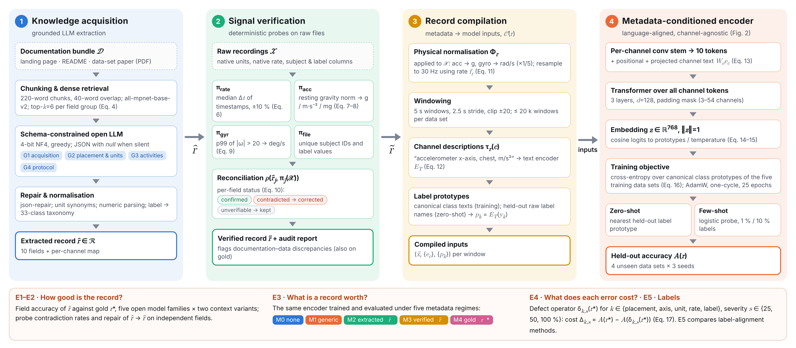

# M2M-HAR: Metadata-to-Model

**Signal-verified knowledge extraction from dataset documentation: measuring what harmonisation metadata is worth for cross-dataset human activity recognition**

[](https://github.com/<your-username>/M2M-HAR/actions/workflows/tests.yml)
[](https://colab.research.google.com/github/<your-username>/M2M-HAR/blob/main/notebooks/M2M_Metadata_to_Model.ipynb)
[](LICENSE)
[](LICENSE-DATA.md)

This repository holds the code, gold records, raw model outputs and every per-run result behind the paper
(under review at *Knowledge-Based Systems*). Every number, table and figure in the paper can be regenerated
from the files here with one command.

Cross-dataset HAR models depend on harmonisation metadata: sampling rate, units, sensor placement and label
meaning. Today that metadata is copied by hand from documentation nobody checks. **M2M** does three things:

1. It extracts a schema-constrained *harmonisation record* from each dataset's documentation with open-weight LLMs.
2. It **verifies** the record against the raw signals with deterministic probes, for example gravity at rest for the accelerometer unit and timestamps for the sampling rate.
3. It measures what each field is worth to a metadata-conditioned encoder, using controlled metadata conditions and injected defects.



## Key results

These figures come from nine public IMU datasets: five for training and four held out.

| Finding | Value |
|---|---|
| LLM extraction, composite field accuracy (5 open LLMs, 4 families) | 0.55–0.71 |
| Accelerometer unit identified by LLMs | 52.2 % |
| Agreement with expert records on signal-verifiable fields, before → after verification | 59.5 % → 95.0 % |
| Accelerometer-unit errors repaired by the gravity probe | 100 % (every model) |
| Cost of wrong activity-label text, 100 % defect (zero-shot accuracy) | 27.6 points (Holm p = 0.009) |
| Cost of wrong accelerometer unit, 100 % defect | 23.1 points (Holm p = 0.013) |
| Cost of wrong placement / sampling rate / axis labels | −0.3 / 1.9 / 3.8 points (n.s.) |
| Verified automatic vs expert metadata, label mapping held fixed (zero-shot) | 36.3 % vs 35.4 % (Δ −0.8, 95 % CI −2.3 to 0.7) |

Unverified extraction (27.0 %) was no better than using no metadata at all (28.2 %).

## Repository structure

```
M2M-HAR/
├── notebooks/M2M_Metadata_to_Model.ipynb   # full pipeline: download → extraction → verification → training → E1–E5
├── src/m2m_tools/                          # reusable components (probes, schema, scoring, stats, harmonisation)
├── analysis/                               # regenerate every paper statistic, table and figure from raw outputs
│   ├── make_paper_figures.py
│   ├── make_extra_figures.py
│   ├── collect_figures.py
│   └── diagrams/                           # Fig. 1 (framework) and Fig. 2 (encoder): HTML sources + renders
├── data/
│   ├── gold_records/                       # expert harmonisation records for the 9 datasets (JSON)
│   ├── schema/harmonisation_record.schema.json
│   └── datasets.md                         # sources of the public datasets
├── results/
│   ├── notebook_outputs/                   # raw outputs of the run used in the paper (E3/E4 runs, audits, LLM outputs)
│   └── paper_analysis/                     # statistics, tables and figures produced by analysis/
├── figures/                                # final paper figures, numbered as in the manuscript (PNG + PDF)
├── examples/audit_your_dataset.py          # apply the probes to your own dataset
├── scripts/                                # read-only .py export of the notebook (for code review and diffs)
├── tests/                                  # unit tests + integrity checks on released artefacts
└── docs/                                   # method, harmonisation-record schema, reproducibility guide
```

## Quick start

```bash
git clone https://github.com/<your-username>/M2M-HAR.git
cd M2M-HAR
python -m venv .venv && source .venv/bin/activate     # Windows: .venv\Scripts\activate
pip install -e ".[analysis,dev]"

pytest -q            # 20 tests: probes, scoring, statistics, gold-record schema, headline result
make figures         # regenerate all statistics, tables and figures from results/notebook_outputs
```

Without `make` (e.g. on Windows):

```bash
python analysis/make_paper_figures.py results/notebook_outputs results/paper_analysis
python analysis/make_extra_figures.py results/notebook_outputs results/paper_analysis results/paper_analysis/figs
python analysis/collect_figures.py
```

`results/paper_analysis/stats.json` then holds every statistic reported in the paper.

## Reproducing the full experiment

Open `notebooks/M2M_Metadata_to_Model.ipynb` in Google Colab (badge above) or Jupyter.

| Mode | Hardware | Time | What it does |
|---|---|---|---|
| `MODE = "SMOKE"` | CPU | minutes | Synthetic datasets and a mock extractor; checks the whole pipeline end to end |
| `MODE = "FULL"` | GPU ≥ 24 GB (paper: Colab L4) | ≈ 1–2 h downloads, ≈ 1 h extraction, ≈ 30–45 h training | The study as reported |

For FULL mode you need a Hugging Face token for the gated models (Mistral, Llama, Gemma). Paste it into
`HF_TOKEN` in the configuration cell at run time and **never commit it**. Every stage caches to `WORK_DIR` and can
be resumed. See [`docs/reproducibility.md`](docs/reproducibility.md) for the exact settings, run order, known
issues and how to compare a new run with the released results.

## Reuse

**Verify your own dataset's documentation** with the probes, which need only NumPy, pandas and SciPy:

```python
from m2m_tools.probes import probe_accelerometer_unit, probe_gyroscope_unit, rate_from_timestamps

unit, g_rest = probe_accelerometer_unit(acc_sessions)   # list of [N, 3] arrays -> ('m/s^2', 9.84)
gyro_unit, p99 = probe_gyroscope_unit(gyro_sessions)    # list of [N, k] arrays -> ('rad/s', 3.9)
rate = rate_from_timestamps(timestamps_in_seconds)      # -> 50.0
```

A complete worked example is in [`examples/audit_your_dataset.py`](examples/audit_your_dataset.py).

You can also reuse:
- **The harmonisation-record schema and gold records.** See `data/schema/` and `data/gold_records/` for nine datasets, with channel maps and raw-label → canonical mappings. Use them for your own cross-dataset training or as a benchmark for metadata extraction.
- **The extraction prompts.** They are in `m2m_tools.schema.build_prompt` and Appendix A of the paper.
- **The raw LLM outputs** of all five models in both context variants, in `results/notebook_outputs/extracted/`. They include the raw generations (`_raw`) for error analysis.

## Datasets

The nine datasets are public and are **not redistributed** here. The notebook downloads them from their original
sources, listed in [`data/datasets.md`](data/datasets.md). Each dataset remains under the terms of its original
repository; please cite the original papers when you use them.

## Citation

If you use this code, the gold records or the results, please cite the paper. Until it is published, use:

```bibtex
@unpublished{alam2026m2m,
  title  = {Signal-verified knowledge extraction from dataset documentation: Measuring what harmonisation
            metadata is worth for cross-dataset human activity recognition},
  author = {Alam, Gulzar and McChesney, Ian and Nicholl, Peter and Rafferty, Joseph},
  note   = {Manuscript under review},
  year   = {2026}
}
```

GitHub's *Cite this repository* button reads [`CITATION.cff`](CITATION.cff).

## Licence

Code: [MIT](LICENSE). Gold records, extracted records and results: [CC BY 4.0](LICENSE-DATA.md). The third-party
datasets keep their own licences.

## Contact

Gulzar Alam, School of Computing, Ulster University, Belfast, UK. Please open a GitHub issue for questions about
the code or data.
