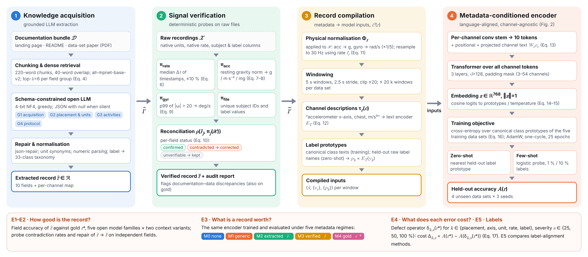
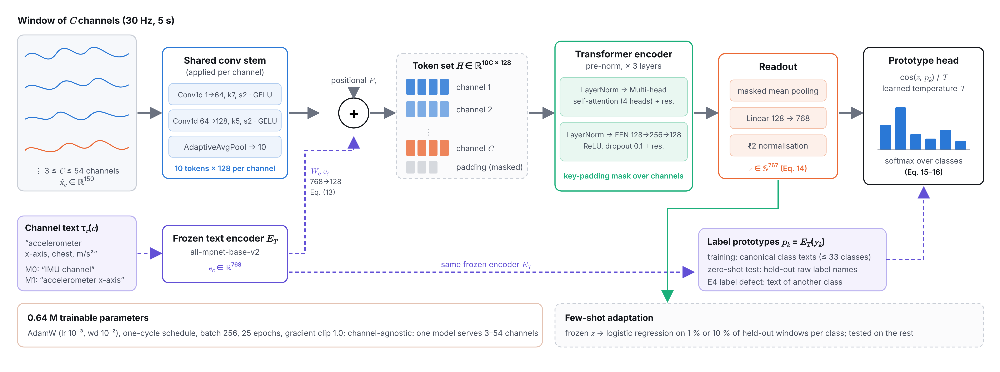

# Method overview

1. **Grounded knowledge acquisition.** The documentation bundle (landing page, README files, dataset paper) is split into 220-word chunks with 40-word overlap and embedded with all-mpnet-base-v2. For each of four field groups (acquisition; placement and units; activities; protocol), the top-6 chunks are retrieved and an open LLM fills a JSON object with the group's fields (`null` when the documentation is silent). The output is repaired (`json-repair`) and normalised.
2. **Signal verification.** Deterministic probes compute the sampling rate, accelerometer unit, gyroscope unit, participant count and label set from the raw files, and the reconciliation rule produces the verified record and an audit report (`docs/harmonisation_record.md`).
3. **Record compilation.** The record determines unit conversion (accelerometer → g; gyroscope → rad/s × 1/5), resampling to 30 Hz, 5-s windows, the text description of each channel, and the label prototypes.
4. **Metadata-conditioned encoder.** A shared convolutional stem turns each channel into 10 tokens. The projected text embedding of the channel description is added to every token, and a Transformer attends over all channels' tokens. The pooled embedding is compared by cosine similarity with text embeddings of activity labels, which gives zero-shot recognition on held-out datasets.

5. **Measuring value.**
   - **E3** trains and evaluates the same encoder under five metadata conditions: M0 none, M1 generic, M2 extracted, M3 verified, M4 gold.
   - **E4** injects one defect type into the training metadata at 25/50/100 % severity: placement, axis, unit, rate or label. The cost is the accuracy lost relative to gold.
   - **E5** compares three label-alignment methods.

All statistics use 12 paired (held-out dataset × seed) differences: bootstrap CI, sign-flip permutation test,
Holm correction within each family, and TOST for equivalence.
